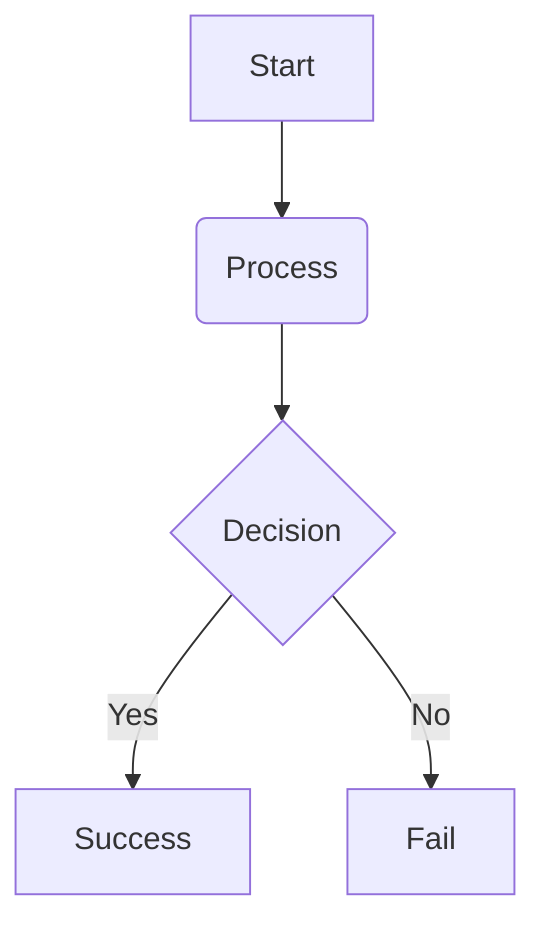

RavenUI is designed to be easily brandable while maintaining its high-performance structural integrity.



RavenUI ships with a dedicated SASS variable layer (`_sass/ravenui-sp/_sass-vars.scss`) that sits above the CSS custom property system. This enables compile-time theme customization — values are resolved at build time and fed into the `:root { }` block, so there is zero runtime overhead.

Every variable carries a `!default` flag, meaning you can override it simply by declaring the variable **before** importing the theme.

**Override Pattern**

In your project's SCSS entry point (typically `assets/css/main.scss`):

```scss
---
---
// Step 1 — declare overrides BEFORE importing the theme
$rd-clr-highlight: #e040fb;          // swap accent: viridian -> violet
$rd-font-sans:     "Inter", sans-serif;
$rd-space-md:      clamp(1.25rem, 1rem + 1.2vw, 1.75rem);
$rd-radius:        6px;

// Step 2 — import the theme (reads your overrides via !default)
@import "ravenui-sp";
```

**Bulk Override Map — `$rd-overrides`**

For projects that manage many tokens, use the map interface instead of individual variables. Keys match the `--rd-*` CSS variable suffix (without the `--rd-` prefix):

```scss
---
---
$rd-overrides: (
  "bg-base":       #0d0d0d,
  "bg-surface":    #121212,
  "clr-highlight": #e040fb,
  "radius":        6px,
  "font-sans":     "'Inter', sans-serif",
  "space-sm":      clamp(0.4rem, 0.3rem + 0.4vw, 0.75rem),
);

@import "ravenui-sp";
```

Map values take precedence over the individual `$rd-*` variable defaults when both are specified.

---

**Core Color Variables**

| SASS Variable | CSS Custom Property | Default |
|---|---|---|
| `$rd-bg-base` | `--rd-bg-base` | `#050505` |
| `$rd-bg-surface` | `--rd-bg-surface` | `#0a0a0a` |
| `$rd-bg-elevated` | `--rd-bg-elevated` | `#111111` |
| `$rd-bg-panel` | `--rd-bg-panel` | `#161B24` |
| `$rd-bg-card` | `--rd-bg-card` | `#1B212B` |
| `$rd-clr-highlight` | `--rd-clr-highlight` | `#00ff9d` |
| `$rd-clr-platinum` | `--rd-clr-platinum` | `#e5e5e5` |
| `$rd-clr-warning` | `--rd-clr-warning` | `#ffcc00` |
| `$rd-clr-danger` | `--rd-clr-danger` | `#ff4444` |
| `$rd-clr-info` | `--rd-clr-info` | `#3399ff` |

**Typography Variables**

| SASS Variable | CSS Custom Property | Default |
|---|---|---|
| `$rd-font-sans` | `--rd-font-sans` | System UI stack |
| `$rd-font-mono` | `--rd-font-mono` | MonaspiceAr / JetBrains Mono |
| `$rd-font-heading` | _(utility class only)_ | Fraunces |
| `$rd-fz-xs` – `$rd-fz-xxl` | _(utility classes)_ | `0.75rem` – `2.5rem` |
| `$rd-fw-normal` – `$rd-fw-black` | _(utility classes)_ | `400` – `900` |

**Spacing Variables**

| SASS Variable | CSS Custom Property | Default |
|---|---|---|
| `$rd-space-sm` | `--rd-space-sm` | `clamp(0.5rem, 0.4rem + 0.5vw, 1rem)` |
| `$rd-space-md` | `--rd-space-md` | `clamp(1rem, 0.8rem + 1vw, 1.5rem)` |
| `$rd-space-lg` | `--rd-space-lg` | `clamp(1.5rem, 1.2rem + 1.5vw, 2.5rem)` |

**Radius Variables**

| SASS Variable | CSS Custom Property | Default |
|---|---|---|
| `$rd-radius` | `--rd-radius` | `4px` |
| `$rd-radius-lg` | `--rd-radius-lg` | `8px` |
| `$rd-radius-xl` | `--rd-radius-xl` | `12px` |

---




To add custom styles without modifying the theme core, you can add them to `assets/css/main.scss`:

```scss
---
---
@import "ravenui-sp";

// Your custom overrides here
.rd-logo {
  font-family: "Custom Font", sans-serif;
}
```

---



RavenUI supports instant color swapping via the `rd_accent_color` field in `_config.yml`. This color will be applied to the progress bar and secondary highlights.

```yaml
rd_accent_color: "#00ff9d" # Emerald
# or
rd_accent_color: "#3399ff" # Sky Blue
```

---

---



To enable support for Mermaid.js diagrams, add `mermaid: true` to your page's front-matter or globally in `_config.yml`:

```yaml
mermaid: true
```

Then you can author diagrams using standard markdown code blocks with the `mermaid` language tag:



---



To enable LaTeX math rendering (powered by KaTeX), add `math: true` to your page's front-matter or globally in `_config.yml`:

```yaml
math: true
```

Now you can write inline math like $E = mc^2$ or block math using double dollar signs:

$$\int_{-\infty}^{\infty} e^{-x^2} dx = \sqrt{\pi}$$

---



For deep structural changes, the theme SCSS is modularized:
- `_root.scss`: Base variables.
- `_layout.scss`: Grid system.
- `_components.scss`: Reusable UI elements.
- `_navigation.scss`: Sidebar and link logic.

