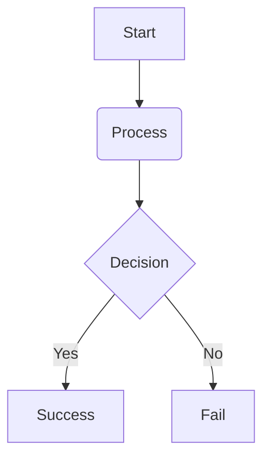

Zero-Dark is designed to be easily brandable while maintaining its high-performance structural integrity.



The theme uses a centralized variable system. To override these, create a `_sass/custom-variables.scss` file (or similar) and import it before the theme.

**Key Variables:**
- `--zd-bg-base`: The primary background color.
- `--zd-clr-highlight`: The main accent color (used for icons, borders, progress bar).
- `--zd-font-sans`: Primary UI font stack.
- `--zd-font-mono`: Technical/code font stack.

---



To add custom styles without modifying the theme core, you can add them to `assets/css/main.scss`:

```scss
---
---
@import "zero-dark-sp";

// Your custom overrides here
.zd-logo {
  font-family: "Custom Font", sans-serif;
}
```

---



Zero-Dark supports instant color swapping via the `zd_accent_color` field in `_config.yml`. This color will be applied to the progress bar and secondary highlights.

```yaml
zd_accent_color: "#00ff9d" # Emerald
# or
zd_accent_color: "#3399ff" # Sky Blue
```

---

---



To enable support for Mermaid.js diagrams, add `mermaid: true` to your page's front-matter or globally in `_config.yml`:

```yaml
mermaid: true
```

Then you can author diagrams using standard markdown code blocks with the `mermaid` language tag:



---



To enable LaTeX math rendering (powered by KaTeX), add `math: true` to your page's front-matter or globally in `_config.yml`:

```yaml
math: true
```

Now you can write inline math like $E = mc^2$ or block math using double dollar signs:

$$\int_{-\infty}^{\infty} e^{-x^2} dx = \sqrt{\pi}$$

---



For deep structural changes, the theme SCSS is modularized:
- `_root.scss`: Base variables.
- `_layout.scss`: Grid system.
- `_components.scss`: Reusable UI elements.
- `_navigation.scss`: Sidebar and link logic.

